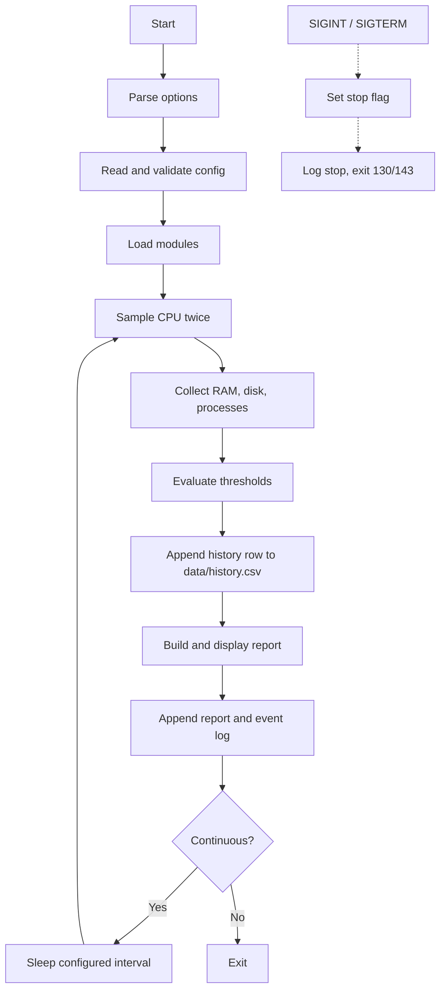

# System Design

## Components
| Module | Responsibility | Data source |
|---|---|---|
| Main controller | CLI, config, orchestration | `monitor.sh` |
| System information | Host, OS, kernel, uptime, timestamp | `hostname`, `/etc/os-release`, `uname`, `uptime`, `date` |
| CPU | Two-sample busy percentage | `/proc/stat` |
| Memory | Total/used/available and percentage | `/proc/meminfo` |
| Disk | Selected filesystem capacity and percentage | `df -Pk` |
| Processes | Top N CPU and memory processes | `ps` |
| Alert manager | Threshold comparison and warning events | `logs/monitor.log` |
| Report manager | Append report by date | `reports/system-report-YYYY-MM-DD.log` |
| History manager (v1.1) | Append one CSV row per cycle, trim, display | `data/history.csv` |
| Terminal helpers (v1.2) | Size, colour and locale detection, alternate screen, flicker-free frames | ANSI escape codes, `stty` |
| Dashboard (v1.2) | Sampling, panels, key handling, refresh loop | `/proc/stat`, `/proc/meminfo`, `df`, `ps` |

## Workflow

## Design decisions
1. CPU is measured across an interval, not from a single instantaneous sample.
2. RAM used is `MemTotal - MemAvailable`.
3. `df -Pk` is parsed for stable numeric filesystem data.
4. Configuration is parsed as key/value data and never executed.
5. Thresholds and CLI values are validated.
6. No unnecessary root privileges are required.
7. The program never kills processes or modifies system settings.
8. Reports and events append rather than overwrite.

### Added in v1.2
14. The dashboard uses plain ANSI escape codes. ncurses/dialog bindings, Python `rich` or wrapping the report in `watch` were rejected: they add dependencies or cannot give keys, colours and a stable layout.
15. Rendering functions only print text and sampling functions only set variables, so both can be tested without a terminal (fake `df`/`ps`, `--frames N` for whole frames).
16. CPU is a delta between refreshes rather than a blocking two-sample measurement; a sample is taken only when due, so a key press redraws without distorting it.
17. Bash's `read -t` is not interrupted by a trapped signal (found by the pseudo-terminal tests), so the key wait is cut into slices of at most 0.2 s and checks for Ctrl+C, `kill` and window resizes between slices.
18. Every exit path (`q`, SIGINT, SIGTERM, EXIT trap) calls the same idempotent `term_leave`, which restores the screen, cursor, line wrapping and tty settings.
19. The frame layout is computed from the terminal size so a frame never wraps or scrolls (tested from 60x18 to 140x40).

### Added in v1.1
9. History uses plain CSV: no database or extra dependency, readable by any spreadsheet or script, and a stable base for later analytics and a terminal dashboard.
10. History is written before the report is built, so a report failure cannot lose a sample; a history failure only warns and never stops monitoring.
11. Concurrent writers are serialized with `flock`; size is bounded by `HISTORY_MAX_ROWS` using an atomic temp-file rename.
12. Signals set a flag instead of exiting mid-write; the main loop stops at a safe point (graceful shutdown, exit 130/143).
13. Arguments are parsed before the configuration is loaded, so `--help` and `--version` never depend on config validity.

## Boundaries
Local Linux host only; no GUI, remote agents, cloud ingestion, network traffic analysis, notifications or predictive analytics in v1.1.
