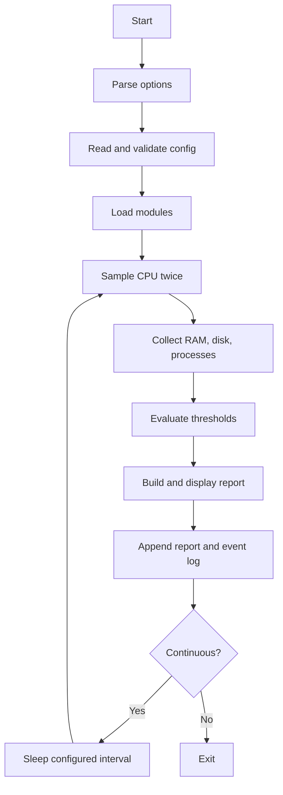

# System Design

## Components
| Module | Responsibility | Data source |
|---|---|---|
| Main controller | CLI, config, orchestration | `monitor.sh` |
| System information | Host, OS, kernel, uptime, timestamp | `hostname`, `/etc/os-release`, `uname`, `uptime`, `date` |
| CPU | Two-sample busy percentage | `/proc/stat` |
| Memory | Total/used/available and percentage | `/proc/meminfo` |
| Disk | Selected filesystem capacity and percentage | `df -Pk` |
| Processes | Top N CPU and memory processes | `ps` |
| Alert manager | Threshold comparison and warning events | `logs/monitor.log` |
| Report manager | Append report by date | `reports/system-report-YYYY-MM-DD.log` |

## Workflow

## Design decisions
1. CPU is measured across an interval, not from a single instantaneous sample.
2. RAM used is `MemTotal - MemAvailable`.
3. `df -Pk` is parsed for stable numeric filesystem data.
4. Configuration is parsed as key/value data and never executed.
5. Thresholds and CLI values are validated.
6. No unnecessary root privileges are required.
7. The program never kills processes or modifies system settings.
8. Reports and events append rather than overwrite.

## Boundaries
Local Linux host only; no GUI, remote agents, cloud ingestion, network traffic analysis, notifications or predictive analytics in v1.0.
